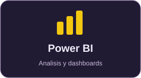
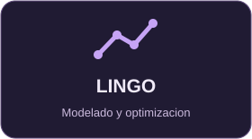
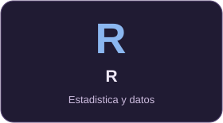

<a href="https://github.com/Lumeris-SP">
  <picture>
    <source media="(prefers-color-scheme: dark)" srcset="assets/banner-dark.v9.svg">
    <source media="(prefers-color-scheme: light)" srcset="assets/banner-light.v9.svg">
    
  </picture>
</a>

### Lumeris · Estudiante de Ingeniería Industrial

**Datos · Procesos · Optimización**

---

## Sobre mí

Soy estudiante de **Ingeniería Industrial** y estoy trabajando con **Power BI**. También utilizo **LINGO** y **R**.

Me interesa explorar cómo los datos y la optimización pueden ayudar a comprender y mejorar los procesos.

## Herramientas

  
  
  

## Actualmente

- Trabajando con Power BI para analizar y visualizar datos.
- Aplicando lo que aprendo en Ingeniería Industrial.

---

  
   
  <a href="https://github.com/Lumeris-SP">Lumeris-SP</a>

